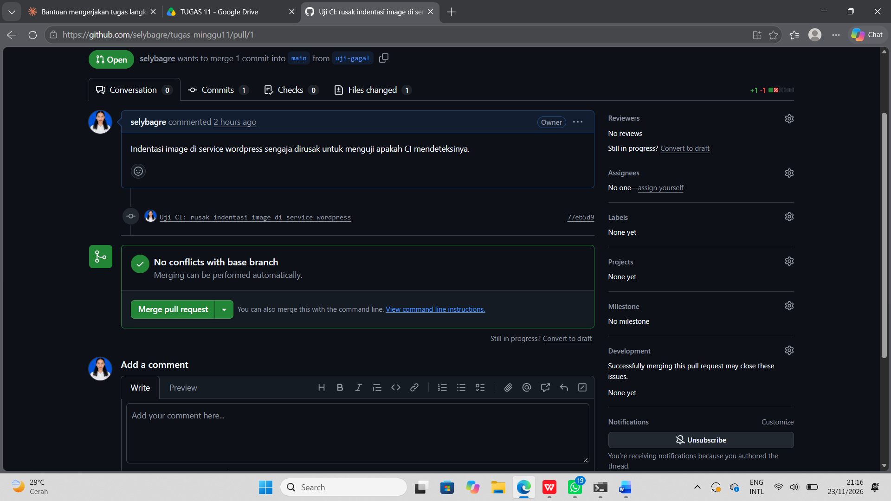
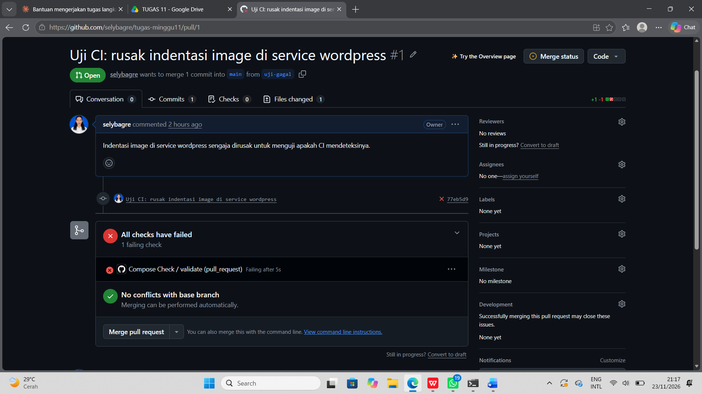
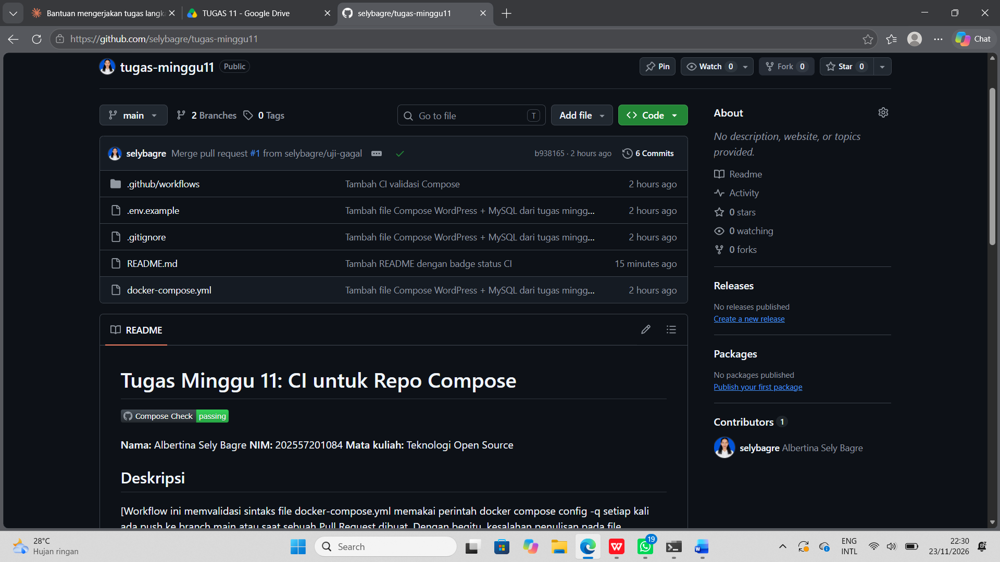

# Tugas Minggu 11: CI untuk Repo Compose

**Nama:** Albertina Sely Bagre
**NIM:** 202557201084
**Mata kuliah:** Teknologi Open Source

## Deskripsi
[Workflow ini memvalidasi sintaks file docker-compose.yml memakai perintah docker compose config -q setiap kali ada push ke branch main atau saat sebuah Pull Request dibuat. Dengan begitu, kesalahan penulisan pada file Compose bisa diketahui sebelum perubahan digabungkan ke main.]

## Isi repositori
- .github/workflows/compose-check.yml : workflow CI
- docker-compose.yml : stack WordPress + MySQL (tugas minggu 10)
- .env.example : contoh variabel lingkungan tanpa rahasia asli
- .gitignore : mengabaikan .env

## Cara kerja workflow
[Workflow bernama Compose Check dipicu oleh dua kejadian, yaitu push ke branch main dan pull_request. Di dalamnya ada satu job bernama validate yang berjalan di runner ubuntu-latest milik GitHub. Job ini punya tiga step. Pertama, actions/checkout mengambil isi repositori ke runner. Kedua, perintah cp .env.example .env membuat file .env dari contoh, karena .env asli tidak ada di repositori dan variabelnya dibutuhkan oleh docker-compose.yml. Ketiga, docker compose config -q memeriksa sintaks file Compose tanpa menjalankan container. Jika semua step berhasil, job berwarna hijau, dan jika ada kesalahan, job berwarna merah..]

## Bukti
1. Run hijau di tab Actions
   
2. Pull Request dengan check gagal (merah)
   
3. Badge status di README
   

Tautan Pull Request (sudah hijau dan di-merge): https://github.com/selybagre/tugas-minggu11/pull/1

## Kendala dan cara mengatasinya
[Kendala pertama: saat pertama kali di-push, file .env.example ternyata masih berisi password asli dari tugas minggu 10 (wppass123 dan rootpass123). Karena repositori ini publik dan password itu sudah masuk ke riwayat commit, saya mengganti isinya dengan nilai contoh, lalu menimpa commit pertama dengan git commit --amend dan git push --force. Setelah itu saya memeriksa dengan git grep bahwa password lama sudah tidak ada di riwayat commit.

Kendala kedua: pada Pull Request uji-gagal, check Compose Check berwarna merah setelah saya menghapus satu spasi di depan baris image pada service wordpress. Log step "Validasi file compose" menampilkan pesan error: [Run docker compose config -q
yaml: line 19, column 10: mapping values are not allowed in this context
Error: Process completed with exit code 1.]. Pesan itu menunjukkan bahwa indentasi YAML salah. Saya memperbaikinya dengan mengembalikan indentasi menjadi 4 spasi, lalu push ke branch yang sama sehingga check berubah hijau dan Pull Request bisa di-merge.]

## Refleksi singkat
[Dengan CI, kesalahan pada file Compose langsung ketahuan di GitHub tanpa perlu menjalankannya satu per satu di laptop. Dalam tugas ini, Pull Request yang merah mencegah file yang rusak masuk ke main begitu saja. Selain itu, CI membuat pengerjaan kelompok lebih aman, karena setiap perubahan dari anggota mana pun diperiksa dengan cara yang sama.]
